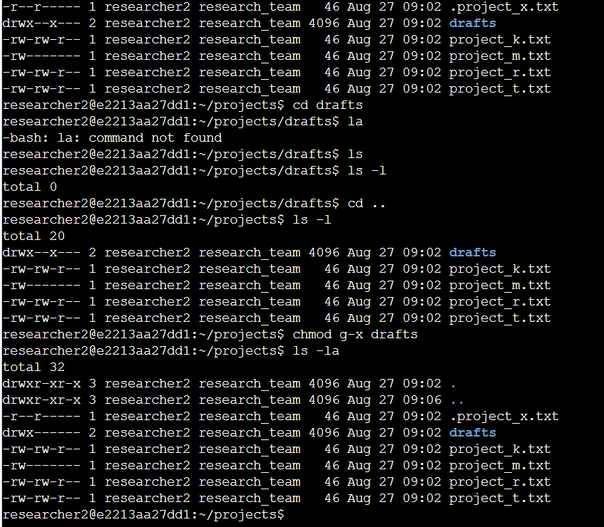

# Linux File Permissions

<b>Course:</b> Tools of the Trade: Linux and SQL &nbsp;|&nbsp; <b>Type:</b> Portfolio activity (my own terminal screenshots) &nbsp;|&nbsp; <b>Tools:</b> Linux, Bash &nbsp;|&nbsp; <b>Skills:</b> Linux, access control, least privilege

## The task

::: scenario
The research team at an organization keeps files in `/home/researcher2/projects`. Their permissions did not match who should be able to use each file. I had to check the current permissions and fix them with Linux commands. The rules were:

- No file should be writable by **other** (everyone outside the owner and group).
- `project_m.txt` should be readable and writable by the owner only.
- `.project_x.txt` is an archived hidden file. The owner and group can read it, and nobody can write to it.
- The `drafts` directory should be accessible to the owner only.
:::

## Step 1: Check the current permissions

I used `ls`, then `ls -l` for the long format, `ls -a` to show hidden files, and `ls -la` to see both together. The hidden file `.project_x.txt` only appeared with `-a`.

**How to read a permission string** such as `-rw-rw-r--`:

| Part | Meaning |
|---|---|
| 1st character | `-` is a file, `d` is a directory |
| Characters 2 to 4 | Owner (user): read `r`, write `w`, execute `x` |
| Characters 5 to 7 | Group |
| Characters 8 to 10 | Other (everyone else) |

A `-` in a slot means that permission is off.

## Step 2: Fix the permissions

| Item | Before | Command | After |
|---|---|---|---|
| `project_k.txt` | `-rw-rw-rw-` | `chmod o-w project_k.txt` | `-rw-rw-r--` |
| `project_m.txt` | `-rw-r-----` | `chmod g-r project_m.txt` | `-rw-------` |
| `.project_x.txt` | `-rw--w----` | `chmod u-w,g+r .project_x.txt` then `chmod g-w .project_x.txt` | `-r--r-----` |
| `drafts` | `drwx--x---` | `chmod g-x drafts` | `drwx------` |

`chmod` takes two parts: what to change (`o-w` means *other*, *remove*, *write*) and the file. On the hidden file my first command left the group with write permission, so I ran a second command to remove it. I checked with `ls -la` after each change.

## What I learned

- A directory needs the **execute** permission for someone to go into it. That is why `g-x` was enough to lock the group out of `drafts`.
- `ls -la` before and after a change is the quickest way to prove a fix worked.
- This is the principle of **least privilege** in practice: each person gets only the access they need.
- Small typing mistakes happen (`0-w` instead of `o-w`). The error message was clear, so I fixed it right away.
