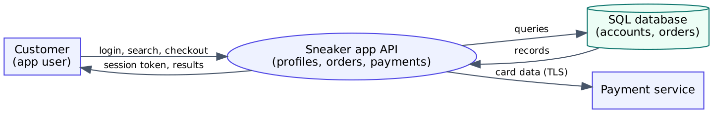
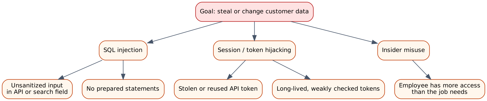

# PASTA Threat Model: Sneaker App

<b>Course:</b> Assets, Threats, and Vulnerabilities &nbsp;|&nbsp; <b>Type:</b> Practice scenario &nbsp;|&nbsp; <b>Tools:</b> PASTA framework &nbsp;|&nbsp; <b>Skills:</b> Threat modeling, web application security, PCI DSS

## The task

::: scenario
A company is building a mobile app where people buy and sell sneakers. Users can create a profile directly or sign in with an outside account, and the app takes payments. I applied the first stages of **PASTA** (Process for Attack Simulation and Threat Analysis) to find what could go wrong. The diagrams below are my own, based on my answers.
:::

## The seven stages

| Stage | My answer |
|---|---|
| **I. Business and security objectives** | Users can sign up in the app or with an outside account. The app takes payments, so it must follow **PCI DSS** and protect personal data. |
| **II. Technical scope** | The app uses an API, public key infrastructure (PKI), SHA-256 and SQL. **I would test the API first.** It moves profile and payment data between users and the back end, and it is exposed to the internet, so it has the biggest attack surface. |
| **III. Decompose the application** | See the data flow diagram below. |
| **IV. Threat analysis** | *Injection:* an attacker puts malicious SQL into an input field or API call to read or change data. *Session hijacking:* an attacker steals or reuses a session or API token to act as the user. *Insider:* an employee with too much access could misuse or leak data. |
| **V. Vulnerability analysis** | *No prepared statements:* if queries are built by pasting in user input, the database is open to SQL injection. *Weak API tokens:* long-lived or poorly checked tokens let an attacker take over a session. |
| **VI. Attack modeling** | See the attack tree below. |
| **VII. Risk analysis and impact** | Four controls reduce the risk: **SHA-256 hashing** (store passwords as salted hashes), **incident response procedures**, a **password policy** (length, complexity, lockout, MFA), and **least privilege** for users and API clients. |

## Data flow diagram

## Attack tree

## What I learned

- PASTA starts from the **business goal**, not from the code. That keeps the threats tied to what the company cares about.
- Drawing the data flow shows the places where data crosses a boundary, and those are the places to protect.
- One weakness (like missing prepared statements) can connect to a whole attack path, which the attack tree makes easy to see.
